<p align="center">
  
</p>

# ⚡ Awesome RAG &amp; Context Engines 🧠🔍

<p align="center">
  <a href="https://github.com/ishandutta2007/Awesome-Awesome-Awesome"></a><a href="https://discord.gg/jc4xtF58Ve"></a> <a href="https://github.com/ishandutta2007/Awesome-RAG-Context-Engines/stargazers"></a> <a href="https://github.com/ishandutta2007/Awesome-RAG-Context-Engines/network/members"></a> <a href="https://github.com/ishandutta2007/Awesome-RAG-Context-Engines/blob/main/LICENSE"></a> <a href="https://github.com/ishandutta2007/Awesome-RAG-Context-Engines/pulls"></a> <a href="https://github.com/ishandutta2007"></a>
</p>

A curated directory and architectural guide dedicated to **Retrieval-Augmented Generation (RAG)**, **Context Engines**, **Vector Databases**, and **Vision-Native Document Intelligence Systems**. 

These platforms form the mission-critical context layer bridging raw enterprise knowledge (complex PDFs, tables, knowledge graphs, codebases) with Large Language Models (LLMs) — delivering deterministic parsing, hybrid retrieval (dense vector + sparse BM25), reranking, and citation-grade grounded responses without hallucinations.

---

## 📑 Table of Contents
- [📊 Sector Overview &amp; Market Dynamics](#-sector-overview--market-dynamics)
- [☁️ SaaS &amp; Hosted RAG Platforms](#️-saas--hosted-rag-platforms)
- [🔓 Open-Source RAG &amp; Context Engines](#-open-source-rag--context-engines)
- [📐 Core Architectural Criteria](#-core-architectural-criteria)
- [🤝 How to Contribute](#-how-to-contribute)
- [💖 Support &amp; Sponsorship](#-support--sponsorship)
- [📈 Star History](#-star-history)
- [⚖️ Disclaimer &amp; License](#️-disclaimer--license)

---

## 📊 Sector Overview &amp; Market Dynamics

The global market for **Retrieval-Augmented Generation (RAG) and Context Engine Infrastructure** is estimated at approximately **$2.1 billion in 2025** and is projected to expand beyond **$12.8 billion by 2030**, exhibiting an accelerated CAGR of ~43% as enterprise AI initiatives shift from experimental conversational chatbots to regulated, zero-hallucination document intelligence workflows.

The sector demonstrates **moderate fragmentation**: while established search infrastructure powerhouses and premier vector databases (such as Elastic, Pinecone, Milvus/Zilliz, and Qdrant) command significant enterprise data volumes, the rapid commoditization of baseline approximate nearest neighbor (ANN) vector indexing prevents a winner-take-all monopoly. Value and competitive moats have decisively migrated up the stack toward specialized context layers: layout-aware vision parsing (OCR segmentation), hybrid multi-vector &amp; knowledge graph retrieval (Graph RAG), and pre-computed curated artifact graphs that ensure exact auditability and deterministic precision.

---

## ☁️ SaaS &amp; Hosted RAG Platforms

The following hosted platforms provide turnkey RAG-as-a-Service, managed serverless vector databases, and enterprise document context pipelines. Entries are sorted descending by **Company Scale (Valuation / Market Capitalization / Revenue)**.

| 🏢 Platform / Product | 💡 Description &amp; Core Context Capabilities | 📈 Company Scale (Valuation / Revenue) | 🏷️ Starting Paid Tier | 🎁 Free Tier &amp; Trial Limits | 🌐 Deployment / Access |
| :--- | :--- | :--- | :--- | :--- | :--- |
| **[Elasticsearch Vector Database](https://www.elastic.co/)** | Serverless vector and lexical search with BBQ (Better Binary Quantization, up to 32x memory compression), auto-calibrated segment merging, bfloat16 storage, and GPU-managed inference via Elastic Inference Service. | **Public (NYSE: ESTC)**<br>~$8.5B Market Cap<br>~$1.3B ARR | **$95.00 / month**<br>(Standard tier baseline compute &amp; storage) | **14-day free trial** with up to 8 GB RAM and 240 GB storage cluster on AWS, GCP, or Azure (full access to ML &amp; vector search). | Managed Cloud (AWS, Azure, GCP) &amp; Self-managed ELv2 |
| **[Pinecone Nexus](https://www.pinecone.io/)** | Retrieval-native managed context engine using pre-computed curated artifacts (summaries, entities, events) queried via a Python retrieval SDK. Executes deterministic counting and table queries via SQL. | **Series B**<br>~$750M Valuation<br>($138M raised) | **$20.00 / month**<br>(Builder tier base fee; Standard from $50/mo minimum commit) | **Free forever (Starter plan)**: up to 2 GB index storage (~300,000 vectors), 2M write units/mo, 1M read units/mo, and 5 serverless indexes. | Managed Serverless Cloud (AWS, GCP, Azure) |
| **[Zilliz Cloud](https://zilliz.com/)** | Fully managed enterprise service for distributed Milvus vector databases, offering automated Vectorize ETL ingestion pipelines, deep multi-tenancy, and hardware-accelerated HNSW/GPU index scaling. | **Series B**<br>~$600M Valuation<br>($113M raised) | **$0.27 / CU-hour**<br>(~$25–$30/mo light usage; Dedicated clusters from $197/mo) | **Free forever**: 5 GB storage (~1M 768-dim vectors), 2.5M vCUs (or 100 CU-hours)/mo, and up to 5 collections; plus **30-day $100 credit trial** for dedicated clusters. | Managed Serverless &amp; Dedicated (AWS, GCP, Azure) |
| **[Weaviate Cloud](https://weaviate.io/)** | Managed AI-native vector search engine with turnkey Query Agent, hybrid BM25 + dense search via RRF fusion, multi-tenant isolation, and automated chunking and ingestion pipelines. | **Series B**<br>~$200M Valuation<br>($67M raised) | **$45.00 / month**<br>(Flex Plan with 99.5% uptime SLA and RBAC) | **Free forever (Always Free Cluster)**: 1 cluster, up to 100,000 objects, 1 GB RAM, 10 GB disk, 1 collection (3 tenants), 2,000 embedding reqs/day, and 1,000 Query Agent reqs/mo. | Managed Serverless &amp; Hybrid Cloud (AWS, GCP, Azure) |
| **[Vectara](https://www.vectara.com/)** | End-to-end RAG-as-a-Service API platform featuring Boomerang neural embeddings, automated chunking, HHEM hallucination detection, and grounded citation generation. | **Series A**<br>~$180M Valuation<br>($28.5M raised) | **$100,000 / year**<br>(Enterprise SaaS deployment; VPC deployment from $250k/yr) | **30-day free trial**: includes 10,000 free platform credits for search operations, document parsing, and generative workflows (no credit card required). | SaaS, Dedicated VPC, &amp; On-Premise Air-gapped |
| **[LlamaCloud](https://cloud.llamaindex.ai/)** | Managed context extraction and indexing platform powered by LlamaParse. Excels at parsing layout-dense PDFs, complex embedded tables, and visual charts into LLM-ready context chunks. | **Series A**<br>~$100M Valuation<br>($8.5M+ raised) | **$50.00 / month**<br>(Starter tier with 50,000 credits/mo and up to $500/mo overage cap) | **Free forever**: 10,000 free parsing/extraction credits per month, 5 concurrent parse/extract/classify jobs, and community support. | Managed Serverless API |
| **[Unstructured Cloud](https://unstructured.io/)** | Serverless document transformation API turning raw PDFs, DOCX, PPTX, and HTML into structured, layout-preserved, and model-ingestible context chunks for vector databases. | **Series B**<br>~$100M Valuation<br>($65M raised) | **$0.015 / page**<br>(Pay-as-you-go serverless API overage rate) | **Free trial credit**: 10,000 free processed document pages upon initial signup (one-time developer credit, no credit card required). | Managed API &amp; VPC Marketplace (AWS/Azure) |
| **[Chroma Cloud](https://trychroma.com/)** | Managed serverless vector database designed for high-velocity AI prototyping, featuring multi-database isolation, hybrid search, and low-latency vector indexing. | **Seed**<br>~$75M Valuation<br>($18M raised) | **$0.33 / GiB-mo storage**<br>+ $2.50 / GiB written (Pay-as-you-go, no base fee) | **Free Starter Plan**: includes $5.00 in free usage credits upon signup, up to 10 databases, and up to 10 team member seats. | Serverless Managed Cloud |

---

## 🔓 Open-Source RAG &amp; Context Engines

A comprehensive collection of active open-source projects for self-hosted RAG, context synthesis, document parsing, and vector infrastructure. 

Repositories are sorted descending by **GitHub Star Count** ⭐.

1. **[Dify](https://github.com/langgenius/dify)** [](https://github.com/langgenius/dify/stargazers)  
   **Production-grade LLM application and RAG workflow engine.** Combines visual prompt engineering, flexible context pipelines, dataset management, multi-model routing, and hybrid vector/full-text retrieval for scalable generative AI systems.

2. **[LangChain](https://github.com/langchain-ai/langchain)** [](https://github.com/langchain-ai/langchain/stargazers)  
   **The universal framework for context-aware LLM agents and multi-retriever chaining.** Delivers hundreds of document loaders, vector store integrations, contextual memory abstractions, and modular retrieval-augmented generation DAGs.

3. **[RAGFlow](https://github.com/infiniflow/ragflow)** [](https://github.com/infiniflow/ragflow/stargazers)  
   **Leading open-source RAG engine with vision-native layout parsing (DeepDoc).** Uses YOLOv8-based layout detection to segment documents prior to OCR, preserving table coordinates, generating pixel-exact bounding box citations, and executing hybrid BM25 + dense vector retrieval.

4. **[Mem0](https://github.com/mem0ai/mem0)** [](https://github.com/mem0ai/mem0/stargazers)  
   **Self-improving personalized memory and context layer for AI assistants and autonomous agents.** Enables continuous context retention, long-horizon user modeling, and adaptive semantic retrieval across diverse agent sessions.

5. **[AnythingLLM](https://github.com/Mintplex-Labs/anything-llm)** [](https://github.com/Mintplex-Labs/anything-llm/stargazers)  
   **All-in-one local-first desktop and enterprise RAG application.** Supports zero-setup document embedding, multi-user workspace management, agent tools, and full privacy-preserving execution with local models (Ollama, LM Studio).

6. **[LlamaIndex](https://github.com/run-llama/llama_index)** [](https://github.com/run-llama/llama_index/stargazers)  
   **Specialized data framework for RAG and context pipelines.** Features 160+ enterprise connectors, advanced chunking strategies, hierarchical indexing, knowledge graphs, and agentic query engines for deep document reasoning.

7. **[Milvus](https://github.com/milvus-io/milvus)** [](https://github.com/milvus-io/milvus/stargazers)  
   **Distributed, cloud-native open-source vector database built for billion-scale similarity search.** Delivers hardware-accelerated indexing (GPU/HNSW/SCaNN), multi-tenancy, and high-throughput real-time streaming RAG.

8. **[LightRAG](https://github.com/HKUDS/LightRAG)** [](https://github.com/HKUDS/LightRAG/stargazers)  
   **Fast and lightweight dual-level retrieval-augmented generation engine.** Seamlessly fuses graph-based entity relationships with vector search to achieve rapid topic discovery, low latency, and comprehensive multi-hop reasoning.

9. **[Qdrant](https://github.com/qdrant/qdrant)** [](https://github.com/qdrant/qdrant/stargazers)  
   **High-performance Rust vector search engine built for filter-heavy RAG workloads.** Provides native hybrid search (dense vectors + BM25 sparse) via Reciprocal Rank Fusion (RRF), fastembed integration, and the `QdrantRAG` abstraction.

10. **[Chroma](https://github.com/chroma-core/chroma)** [](https://github.com/chroma-core/chroma/stargazers)  
    **Lightweight, developer-centric embedding database for rapid RAG prototyping.** Offers a clean four-function API (`create_collection`, `add`, `query`, `get`), local zero-config persistence, and native Python and TypeScript SDKs.

11. **[Haystack](https://github.com/deepset-ai/haystack)** [](https://github.com/deepset-ai/haystack/stargazers)  
    **Production-ready modular orchestration framework for RAG and search pipelines by deepset.** Features explicit typed DAG pipelines, custom evaluators, and flexible document processing integrations.

12. **[Kotaemon](https://github.com/Cinnamon/kotaemon)** [](https://github.com/Cinnamon/kotaemon/stargazers)  
    **Open-source, clean UI-driven RAG framework for complex document QA.** Features interactive visual citations, bounding-box PDF previews, multi-vector indexing, and hybrid local/cloud model execution.

13. **[Weaviate](https://github.com/weaviate/weaviate)** [](https://github.com/weaviate/weaviate/stargazers)  
    **Open-source vector database supporting multi-modal embeddings, vector search, and hybrid BM25 retrieval.** Features modular vectorizers, multi-tenant partitioning, and native GraphQL/REST interfaces.

14. **[R2R](https://github.com/SciPhi-AI/R2R)** [](https://github.com/SciPhi-AI/R2R/stargazers)  
    **State-of-the-art open-source agentic RAG engine with automated hybrid graph-vector retrieval.** Handles universal document processing across 40+ file formats, granular RBAC permissions, and real-time observability telemetry.

15. **[Verba](https://github.com/weaviate/Verba)** [](https://github.com/weaviate/Verba/stargazers)  
    **Turnkey personal RAG assistant powered by Weaviate.** Provides a responsive web interface for uploading files, configuring semantic chunking algorithms, and exploring document context locally.

16. **[Marqo](https://github.com/marqo-ai/marqo)** [](https://github.com/marqo-ai/marqo/stargazers)  
    **AI-native search engine designed for multimodal retrieval and product discovery.** Combines tensor search with lexical scoring, image embedding caching, and sub-millisecond query execution.

---

## 📐 Core Architectural Criteria

When evaluating or building a **RAG &amp; Context Engine** stack, consider these four core architectural pillars:

```
┌────────────────────────────────────────────────────────────────────────┐
│                   RAG & CONTEXT PIPELINE FLOW                          │
│                                                                        │
│   [Raw Unstructured Docs]  ──>  [Layout-Aware Parser / OCR]            │
│                                            │                           │
│                                            ▼                           │
│   [Curated Artifacts / Graph] <──  [Hybrid Chunking & Embedding]       │
│                │                                   │                   │
│                ▼                                   ▼                   │
│   [Deterministic Graph Query]       [Dense + BM25 Sparse Search]       │
│                │                                   │                   │
│                └───────────────┬───────────────────┘                   │
│                                ▼                                       │
│                     [Cross-Encoder Reranker]                           │
│                                │                                       │
│                                ▼                                       │
│                [Grounded LLM Context Window]                           │
│                                │                                       │
│                                ▼                                       │
│            [Pixel-Exact Citations & Verification]                      │
└────────────────────────────────────────────────────────────────────────┘
```

1. **Document Understanding &amp; Layout Awareness**: Plain-text extractors fail on tables, multi-column articles, and charts. Engines like **RAGFlow (DeepDoc)** and **LlamaParse** preserve 2D coordinates and table bounding boxes.
2. **Hybrid Retrieval (Dense + Sparse)**: Pure vector search struggles with acronyms, part numbers, and exact IDs. Combining dense embeddings with BM25 via **Reciprocal Rank Fusion (RRF)** (as in Qdrant, Weaviate, Elastic) ensures high recall.
3. **Curated Artifacts vs. Raw Chunks**: Pushing hundreds of raw text chunks into prompt windows degrades LLM reasoning. Platforms like **Pinecone Nexus** summarize knowledge into typed artifacts queried via code/SQL.
4. **Citation Grounding &amp; Hallucination Prevention**: Mission-critical enterprise RAG demands direct verification. Tools like **Vectara (HHEM)** and **RAGFlow** provide visual pixel-exact bounding boxes linking claims back to original sources.

---

## 🤝 How to Contribute

Contributions from the AI and developer community are warmly welcome!

1. **Fork the repository** to your GitHub account.
2. **Create a descriptive feature branch**: `git checkout -b add-my-rag-project`.
3. **Add or update the entry** in `README.md`:
   - Follow the established table or list format.
   - For SaaS products: include exact starting price, specific free tier limits, and verifiable company scale.
   - For open-source repos: include repo link, description, and the social star badge format.
4. **Submit a Pull Request** with a succinct explanation of the addition and relevant documentation links.

---

## 💖 Support &amp; Sponsorship

Thank you for exploring and utilizing **Awesome-RAG-Context-Engines**! 🚀

If this repository helps you navigate the rapidly evolving retrieval and context architecture ecosystem, please consider supporting the project:

- ⭐ **Star this repository** to improve visibility and help other AI developers discover it.
- 🍴 **Fork the repo** to benchmark your own custom context engines.
- 📢 **Share with colleagues** and AI engineering communities on Twitter/X, LinkedIn, and Discord.
- ☕ **Sponsor or buy a coffee** to support ongoing research and curated maintenance:  
  👉 **[Support on GitHub Sponsors](https://github.com/sponsors/ishandutta2007)** 💖

---

## 📈 Star History

[](https://star-history.dera.page/#ishandutta2007/Awesome-RAG-Context-Engines&type=date&legend=top-left)

---

## ⚖️ Disclaimer &amp; License

- This list is **community-curated** for educational, engineering, and research purposes. Product names and trademarks belong to their respective owners.
- Distributed under the **[MIT License](LICENSE)**.
- Made with ❤️ for AI engineers, RAG practitioners, and teams building next-generation grounded context intelligence.